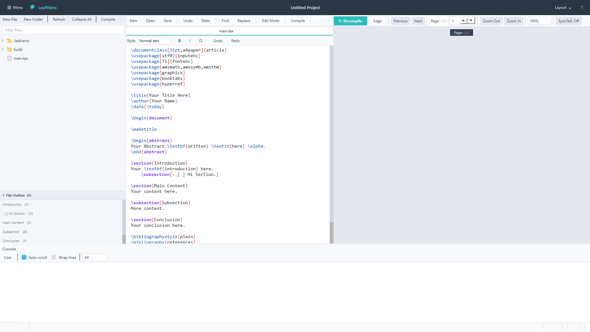

<p align="center">
  
</p>

# LeafVeins

A standalone LaTeX desktop editor for Windows with a live PDF preview, SyncTeX navigation, project management, and an Overleaf-inspired web-style interface — without Docker, WSL, or a server.



## Why LeafVeins?

LeafVeins gives you a focused local writing environment for LaTeX projects. It uses your installed LaTeX toolchain (`latexmk`, `pdflatex`, `xelatex`, or `lualatex`) for compilation and renders the resulting PDF directly inside the app.

It is designed for writers who want:

- A familiar Overleaf-like layout on the desktop
- Fast editing with syntax highlighting and useful LaTeX shortcuts
- A integrated PDF viewer with text selection and SyncTeX jumps
- Multiple source files open at once in a tab set
- A clean project tree, file outline, logs, and configurable themes

## Features

### Writing and editing

- LaTeX syntax highlighting for commands, environments, math, comments, and headings
- Line numbers, current-line highlighting, bracket matching, and configurable font/tab settings
- Auto-save with a configurable interval
- Find and replace bar with case/word options
- Edit Mode ribbon with common LaTeX formatting actions
- Symbol picker for inserting LaTeX symbols
- Source / Visual mode switch (Visual mode currently shows a styled placeholder banner)
- Multiple `.tex` files open simultaneously
  - Click tabs to switch documents
  - `×` on each tab closes that document
  - Cursor position, text, and modified state are preserved per tab
  - Unsaved files prompt before closing
- Live **File Outline** generated from document headings
  - Detects `\chapter`, `\section`, `\subsection`, `\subsubsection`, `\paragraph`, and `\subparagraph`
  - Click an outline entry to jump to that source line

### Projects and files

- Create, open, and manage LaTeX projects
- Project file tree with LaTeX-oriented filtering
- Recent projects tracked in a local SQLite database
- Per-project metadata stored under `.leafveins/config.json`
- Create new `.tex` files inside the current project

### Compilation and preview

- Compile with your local LaTeX distribution
- `latexmk`-driven builds into a `build/` output directory
- Support for `pdflatex`, `xelatex`, and `lualatex`
- Bibliography/index options: BibTeX, Biber, and MakeIndex
- Infinite Build and stop/timeout controls
- Compilation log with error lines that can jump back to source
- PDF preview with:
  - Page rendering via `pypdfium2`
  - Text selection, double-click word selection, and copy
  - Zoom with stable cached rendering
  - Page navigation and fit controls
  - Forward SyncTeX: editor cursor to PDF position
  - Inverse SyncTeX: PDF click to editor line

### Interface

- Four themes: **Dark**, **Light**, **System**, and **Overleaf**
- Overleaf theme matches the web-style reference design in `theme/overleaf_web_latex_editor.html`
- Web-style header with project title, Menu, Layout, and Help controls
- Layout modes: Editor + PDF, Editor only, PDF only
- Toggleable file tree, PDF preview, and log console
- Toast notifications for layout/theme actions
- Bundled teal leaf icon (`#2fbcbc`) used for both the window and executable

## Requirements

- Windows 10 or 11
- Python 3.12 recommended (3.10+ may work)
- A LaTeX distribution installed and available on `PATH`:
  - [MiKTeX](https://miktex.org/download) — recommended on Windows
  - [TeX Live](https://www.tug.org/texlive/)
- `latexmk` and Perl available to the compiler
  - MiKTeX includes the needed tools
  - If `latexmk` reports a missing Perl, install Git for Windows or a Perl distribution and ensure its `usr/bin` is on `PATH`

## Install from source

```powershell
git clone https://github.com/<your-account>/LeafVeins.git
cd LeafVeins
python -m pip install -r requirements.txt
```

Run the app:

```powershell
python app/main.py
```

Or:

```powershell
python -m app.main
```

Take a screenshot for verification:

```powershell
python app/main.py --screenshot screenshot.png
```

## Build the Windows executable

The build script produces a single-file executable at `dist\LeafVeins.exe` and embeds the LeafVeins icon.

```powershell
python build.py
```

Before building, close any running `LeafVeins.exe` process. Otherwise PyInstaller can fail with `PermissionError: [WinError 5] Access is denied` while replacing the old executable.

The build uses:

```text
PyInstaller --onefile --windowed
--icon=app/resources/icons/app.ico
--add-data=app/resources;resources
```

## Quick start

1. Launch LeafVeins.
2. Create or open a project. A project is a directory containing `main.tex`.
3. Edit source files in the editor. Open more `.tex` files from the file tree.
4. Press `F5` or click **Recompile** to build the PDF.
5. Click in the PDF to jump back to source when SyncTeX is enabled.
6. Use **View → Theme** to select `dark`, `light`, `system`, or `overleaf`.

## Compilation details

LeafVeins invokes `latexmk` with a deterministic output layout:

```text
latexmk -cd -jobname=output -auxdir=build -outdir=build -synctex=1 -interaction=batchmode -time -f -pdf main.tex
```

This means:

- Source is compiled from the project directory
- Output PDF is written to `build\output.pdf`
- Auxiliary files are kept in `build\`
- SyncTeX data is generated for editor/PDF navigation
- Compilation continues far enough to produce useful logs even when errors occur

Compiler paths and options can be configured in the settings layer under `app/core/config.py`.

## Keyboard shortcuts

| Shortcut | Action |
| --- | --- |
| `Ctrl+N` | New file |
| `Ctrl+O` | Open project |
| `Ctrl+S` | Save current file |
| `Ctrl+Shift+S` | Save As |
| `Ctrl+W` | Close current file |
| `F5` | Compile |
| `Ctrl+.` | Stop compilation |
| `Ctrl+F` | Find |
| `Ctrl+H` | Replace |
| `Ctrl+G` | Go to line |
| `Ctrl+/` | Toggle comment |
| `Ctrl+B` | Bold selection |
| `Ctrl+I` | Italic selection |
| `Ctrl+Alt+J` | Jump from editor to PDF (SyncTeX) |
| `Ctrl+Click` in PDF | Jump from PDF to editor (SyncTeX) |
| `Ctrl+1` | Toggle file tree |
| `Ctrl+2` | Toggle PDF preview |
| `Ctrl+3` | Toggle console |

## Configuration and data

Settings are stored outside the source tree:

```text
%APPDATA%\LeafVeins\config.json
%APPDATA%\LeafVeins\leafveins.db
```

Managed settings include:

- Editor font, size, tab width, wrapping, auto-save, and Edit Mode
- Preview zoom and refresh behavior
- Compiler paths, timeouts, bibliography options, and SyncTeX
- Selected theme and window/splitter layout
- Recent project list

## Project structure

```text
LeafVeins/
├── app/
│   ├── main.py                     # Application entry point
│   ├── core/
│   │   ├── app.py                  # Main window, menus, layout, theme application
│   │   ├── config.py               # JSON-backed configuration
│   │   ├── database.py             # SQLite project/history storage
│   │   └── themes.py               # Palette registry and web QSS tokens
│   ├── ui/
│   │   ├── editor/
│   │   │   ├── editor_widget.py    # Editor, tabs, find/replace, formatting ribbon
│   │   │   ├── highlighter.py      # LaTeX syntax highlighting
│   │   │   └── symbol_picker.py    # Symbol insertion dialog
│   │   ├── preview/
│   │   │   └── pdf_viewer.py       # PDF rendering, selection, zoom, SyncTeX
│   │   ├── file_tree/
│   │   │   └── file_tree_widget.py # Project tree and file outline
│   │   └── console/
│   │       └── log_widget.py       # Compilation log view
│   ├── compiler/
│   │   └── compiler_manager.py     # latexmk and SyncTeX process handling
│   ├── project/
│   │   └── project_manager.py      # Project metadata and recent projects
│   └── resources/
│       └── icons/                  # App/window/executable icon artwork
├── docs/
│   └── screenshots/                # Curated screenshots used by this README
├── theme/
│   └── overleaf_web_latex_editor.html  # Web UI design reference
├── build.py                        # PyInstaller build script
└── requirements.txt
```

## Troubleshooting

### `latexmk` or `perl` is not found

Install MiKTeX and Git for Windows, then confirm these are on `PATH`:

```text
C:\Program Files\MiKTeX\miktex\bin\x64
C:\Program Files\Git\usr\bin
```

Restart LeafVeins after changing `PATH`.

### `.tex` files are missing from the file tree

LeafVeins filters generated hidden-extension backups. If a real source file is hidden, check that its final extension is exactly `.tex` and that it is not part of a generated backup pattern.

### PDF preview crashes or selection stops working

Use the bundled `pypdfium2` rendering path. Do not switch back to sharing PIL buffer memory with a freed native bitmap — the current renderer owns its pixel data before converting to `QImage`.

### Build fails with access denied

Close all running LeafVeins processes, then rerun `python build.py`.

### Visual mode does not render a WYSIWYG page

Visual mode is currently a styled placeholder. Source editing remains fully active and is the supported editing mode.

## Roadmap / known limitations

- Full WYSIWYG Visual editing is not implemented yet.
- Sharing, Review, History, and Chat are intentionally not present in the desktop header.
- The app is currently Windows-focused because of its compiler-path handling and executable build script.

## Acknowledgments

LeafVeins is inspired by Overleaf and AyakaLeaf Pro. It is not affiliated with or endorsed by Overleaf. Built with PyQt6 and pypdfium2.

## License

See license document for more details. 
